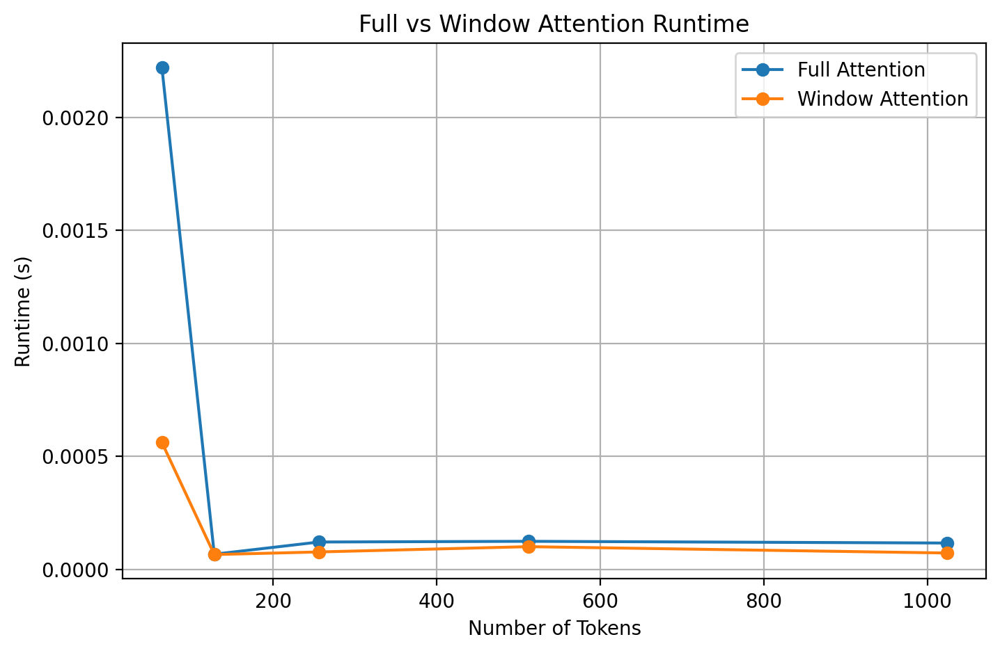

# Attention Week Project

## Project Overview

This repository collects the Week 3 Attention Week demos for:

- HuggingFace tokenizer basics
- Transformer tensor-shape flow
- CLIP-VLM image-text similarity

The repository is being prepared as a research-style project. This stage preserves only the demos and outputs that were actually completed.

## Project Structure

```text
attention-week-project/
├── README.md
├── REPORT.md
├── requirements.txt
├── .gitignore
├── configs/
├── src/
├── experiments/
│   └── week3/
├── tests/
├── outputs/
│   ├── figures/
│   ├── logs/
│   └── metrics/
└── docs/
    └── debug_notes.md
```

## Environment

The original project was developed in a Windows + conda workflow. The current code uses `pathlib` and repository-relative paths so the same commands can run on Windows, Linux, or macOS.

- `torch`
- `transformers`
- `pillow`
- `pyyaml`

## Installation

```bash
pip install -r requirements.txt
```

## Available Demos

- `experiments/week3/tokenizer_demo.py`
- `experiments/week3/transformer_shape_demo.py`
- `experiments/week3/clip_vlm_demo.py`

## Basic Usage

Run the demos from the repository root:

```bash
python -m experiments.week3.tokenizer_demo --config configs/tokenizer.yaml
python -m experiments.week3.transformer_shape_demo --config configs/transformer.yaml
python -m experiments.week3.clip_vlm_demo --config configs/clip.yaml
```

The CLIP demo falls back to synthetic local images when `configs/clip.yaml` does not provide `image_inputs`.

## Configs

- `configs/tokenizer.yaml`: tokenizer model name and example texts
- `configs/transformer.yaml`: seed and Transformer shape parameters
- `configs/clip.yaml`: CLIP model name, texts, optional image inputs, and output path

## Outputs

Formal outputs are stored under `outputs/`:

- `outputs/figures/`
- `outputs/logs/`
- `outputs/metrics/`

Current preserved outputs:

- tokenizer output screenshot
- Transformer shape screenshot
- CLIP-VLM success screenshot
- tokenizer log text
- CLIP similarity matrix summary
- attention shape diagram

## Reproducibility Notes

- The completed scope is limited to tokenizer, Transformer shape, CLIP-VLM, and the attention-shape diagram.
- No new experimental results are introduced in this repository stage.
- Some future Attention Week experiments are intentionally not included yet.
- Local validation in the `vla` conda environment succeeded with the three commands above.

## Known Limitations

- Not all planned Attention Week experiments have been implemented.
- The CLIP demo uses a synthetic local-image fallback when image paths are not supplied.
- Full paper-style analysis and broader ablation work are not yet present.


# Multi-Head Self-Attention 手写实现

## 实验简介

本实验不使用 PyTorch 内置的 `MultiheadAttention`、ViT 或 Swin Transformer 模块，而是从零实现 Vision Transformer（ViT）中的核心组件：

**Multi-Head Self-Attention（多头自注意力机制）**

实现内容包括：

- Query、Key、Value 的线性映射
- Scaled Dot-Product Attention（缩放点积注意力）
- Multi-Head Attention 的多头拆分与合并
- Attention Weight（注意力权重）计算
- 输出投影层

整体计算公式如下：

\[
Attention(Q,K,V)=softmax(\frac{QK^T}{\sqrt{d_k}})V
\]

其中：

- \(Q\)：Query，表示当前 token 想寻找的信息
- \(K\)：Key，表示 token 可以提供的信息类型
- \(V\)：Value，表示实际传递的信息内容
- \(d_k\)：每个 attention head 中 Query/Key 向量的维度

---

# 文件结构
models/
└── attention.py
|
└── MultiHeadSelfAttention

experiments/
└── week4/
|
└── mha_demo.py


其中：

- `models/attention.py`

  存放手写实现的 Multi-Head Self-Attention 模块。

- `experiments/week4/mha_demo.py`

  用于测试该模块，通过模拟 Vision Transformer 中的 patch embedding 输入验证实现是否正确。

---

# 实验设置

本实验使用模拟的 Vision Transformer patch embedding 作为输入。

参数设置：

- Batch Size：2
- Patch 数量（Token 数量）：64
- Embedding Dimension：256
- Attention Head 数量：8

输入张量形式：
(B, N, D)


其中：

- `B`：batch size，即一次输入的图片数量
- `N`：图片被划分后的 patch/token 数量
- `D`：每个 patch 的特征维度

该形式对应 ViT 中经过 Patch Embedding 后的输入格式。

---

# 运行结果

## 1. 输入（Input）

运行输出：
torch.Size([2, 64, 256])


含义：

- `2`：当前 batch 中包含 2 张图片
- `64`：每张图片被划分为 64 个 patch/token
- `256`：每个 patch 使用 256 维向量表示


该输入表示：
2张图片

↓

每张图片64个视觉token

↓

每个token由256维特征表示


符合 Vision Transformer 中 patch embedding 后的数据结构。

---

## 2. 输出（Output）

运行输出：
torch.Size([2, 64, 256])


输出保持与输入相同的维度。

原因：

Self-Attention 不会改变：

- token 数量
- embedding 维度

它的作用是：

通过计算不同 patch 之间的注意力权重，让每个 patch 融合其他 patch 的上下文信息。

因此：

输入时：
Patch_i = 当前区域的局部视觉信息


经过 Attention 后：
Patch_i = 当前区域信息 + 其他相关patch提供的上下文信息


每个 patch 的表示能力得到增强。

---

## 3. Attention Map（注意力矩阵）

运行输出：
torch.Size([2, 8, 64, 64])


该张量表示 Multi-Head Self-Attention 中不同 patch 之间的信息交互关系。


维度含义：


(batch_size, num_heads, query_tokens, key_tokens)


对应：


- `2`：batch size
- `8`：attention head 数量
- `64`：Query token 数量
- `64`：Key token 数量


因此：


每一个 attention head 都会产生一个：


64 × 64


的注意力矩阵。


矩阵中的元素：


\[
Attention(i,j)
\]


表示：


> 在更新第 i 个 patch 的表示时，第 j 个 patch 对它的重要程度。


例如：


如果：


Attention(1,5)=0.8


表示：


第1个patch在更新自身特征时，会大量参考第5个patch提供的信息。


---


# 实现验证总结


本实验成功从零实现了 Multi-Head Self-Attention，并验证了其核心流程。


实现包括：


## 1. Query、Key、Value生成


通过可学习线性层：


\[
Q=XW_Q
\]


\[
K=XW_K
\]


\[
V=XW_V
\]


将输入 token 映射到不同的信息空间。


---


## 2. Scaled Dot-Product Attention


计算 Query 与 Key 的匹配程度：


\[
Score=\frac{QK^T}{\sqrt{d_k}}
\]


然后通过 Softmax 得到 Attention Weight：


\[
A=softmax(Score)
\]


---


## 3. Value 信息聚合


利用注意力权重融合不同 token 的信息：


\[
Output=AV
\]


使每个 patch 获得来自其他 patch 的上下文信息。


---


## 4. Multi-Head Attention


将 embedding 维度拆分为多个 attention head：


256维embedding

↓

8个head

↓

每个head独立计算attention

↓

拼接(concat)

↓

输出投影


不同 head 可以学习不同类型的视觉关系，例如：


- 局部纹理关系
- 物体结构关系
- 长距离语义关系


---


# 实验结论


通过本实验，成功复现了 Vision Transformer 中最核心的 Self-Attention 模块。


实验输出：


Input:
torch.Size([2,64,256])

Output:
torch.Size([2,64,256])

Attention Map:
torch.Size([2,8,64,64])


符合标准 Transformer Attention 工作流程。


该实现验证了：


- Patch token 可以通过 Attention 进行全局信息交互
- 每个 patch 可以动态选择需要关注的其他 patch
- Multi-Head Attention 能够学习不同空间关系


该模块对应 MiniViT-Full 中 Transformer Encoder 的核心计算部分。


# 手写 RoPE，并在 MiniViT-Full Attention 中实现 2D Axial RoPE

## 1. 实验目标

本实验目标是从零实现 Rotary Position Embedding (RoPE)，并将其应用到基于 Vision Transformer (ViT) 的 Multi-Head Self-Attention 中，实现适用于二维 patch grid 的 2D Axial RoPE。

Transformer 的 Self-Attention 本身不包含位置信息，只能学习 token 之间的相关性，而无法知道每个 patch 在图像中的空间位置。因此需要引入位置编码。

相比传统的 Absolute Positional Embedding：

\[
X'=X+P
\]

RoPE 不直接添加位置向量，而是通过旋转 Query 和 Key，使 Attention score 中自然包含位置信息。

本实验实现：

- 1D Rotary Position Embedding
- 2D Axial Rotary Position Embedding
- 将 2D RoPE 集成到手写 Multi-Head Self-Attention 中


---

# 2. RoPE 数学原理

## 2.1 一维 RoPE

RoPE 的核心思想是：

对于输入向量中的两个维度：

\[
(x_1,x_2)
\]

根据当前位置生成旋转角度：

\[
\theta
\]


通过二维旋转矩阵：

\[
\begin{bmatrix}
cos\theta & -sin\theta\\
sin\theta & cos\theta
\end{bmatrix}
\]

得到新的表示：

\[
\begin{bmatrix}
x'_1\\
x'_2
\end{bmatrix}
=
\begin{bmatrix}
cos\theta & -sin\theta\\
sin\theta & cos\theta
\end{bmatrix}
\begin{bmatrix}
x_1\\
x_2
\end{bmatrix}
\]


在 Attention 中，RoPE 作用于 Query 和 Key：

\[
Q'=RoPE(Q)
\]

\[
K'=RoPE(K)
\]


随后计算：

\[
Attention(Q',K',V)
=
softmax
(
\frac{Q'K'^T}{\sqrt{d_k}}
)
V
\]


RoPE 不改变 token 数量和 embedding 维度，只改变向量表示方式。


---

# 3. 为什么需要 2D Axial RoPE？

文本 Transformer 中 token 通常是一维序列：
token1 token2 token3 ...


但是 Vision Transformer 中输入来自图像 patch：


例如：


8 × 8 patch grid

(0,0) (0,1) (0,2) ... (0,7)

(1,0) (1,1) (1,2) ... (1,7)

...

(7,0) (7,1) ... (7,7)


每个 patch 同时具有：


- 横向位置 (column)
- 纵向位置 (row)


因此二维图像不能简单使用一维位置编码。


2D Axial RoPE 将 embedding dimension 拆分为两个方向：


Embedding Dimension

    |
    |

+---------------+
| |
| Row RoPE |
| |
+---------------+

+---------------+
| |
| Column RoPE |
| |
+---------------+


分别对：


- height axis
- width axis


进行旋转编码。


---


# 4. 实现结构


项目结构：


attention-week-project/

├── models/
│
│ ├── attention.py
│ │ 手写 Multi-Head Self-Attention
│ │ 支持 RoPE 开关
│ │
│ └── rope.py
│ RotaryEmbedding
│ AxialRoPE2D
│
│
└── experiments/
│
└── week4/
│
├── mha_demo.py
│ 普通 Multi-Head Attention 测试
│
├── rope_demo.py
│ 2D patch grid 测试
│
├── rope_apply_demo.py
│ RoPE Q/K旋转测试
│
└── mha_rope_demo.py
MiniViT-style Attention + RoPE测试


---


# 5. 核心实现逻辑


## 5.1 Multi-Head Self-Attention


输入：


\[
X\in R^{B\times N\times D}
\]


其中：


- B: batch size
- N: patch token数量
- D: embedding dimension


首先生成：


\[
Q=XW_Q
\]


\[
K=XW_K
\]


\[
V=XW_V
\]


然后划分多个 attention heads：


(B,N,D)

↓

(B,heads,N,head_dim)


---


## 5.2 加入 2D Axial RoPE


原始流程：


Q,K,V

↓

Attention

↓

Output


加入 RoPE 后：


Q,K,V

↓

2D Axial RoPE(Q,K)

↓

Attention

↓

Output


注意：


RoPE 只作用于：


- Query
- Key


不作用于：


- Value


原因：


Query 和 Key 决定 token 间的匹配关系，而 Value 负责信息传递。


---


# 6. 实验验证


## 6.1 Patch Grid位置验证


运行：


```bash
python -m experiments.week4.rope_demo

输出：

Number of patch positions:
64


First 10 positions:
[
(0,0),
(0,1),
(0,2),
(0,3),
(0,4),
(0,5),
(0,6),
(0,7),
(1,0),
(1,1)
]

说明：

8×8 patch grid 被正确转换为二维空间坐标。

6.2 RoPE Q/K旋转验证

运行：

python -m experiments.week4.rope_apply_demo

输出：

Input Q:
torch.Size([2,8,64,32])


Output Q:
torch.Size([2,8,64,32])


Input K:
torch.Size([2,8,64,32])


Output K:
torch.Size([2,8,64,32])

说明：

RoPE不会改变 Query 和 Key 的 tensor shape，只改变其内部表示。

6.3 MiniViT-Full Attention + RoPE验证

运行：

python -m experiments.week4.mha_rope_demo

输出：

Input:
torch.Size([2,64,256])


Output:
torch.Size([2,64,256])


Attention map:
torch.Size([2,8,64,64])

结果解释：

输入：

(B,N,D)

其中：

B = 2
N = 64 patch tokens
D = 256 embedding dimension

输出保持：

(B,N,D)

说明 Attention 模块结构保持正确。

Attention map：

(B,H,N,N)

其中：

H = 8 attention heads
N = 64 patches

表示每个 head 学习 patch 与 patch 之间的空间关联。


# Window Attention Implementation for MiniViT-Window

## 1. 实验目标

本实验目标是手写实现 Window Attention，并理解其在 Vision Transformer 中的作用。

传统 Vision Transformer (ViT) 使用 Global Self-Attention：

\[
Attention(Q,K,V)
=
softmax
(
\frac{QK^T}{\sqrt{d_k}}
)
V
\]

它允许所有 patch 两两交互，但是随着图像分辨率增加，token 数量快速增长，Attention 的计算复杂度为：

\[
O(N^2)
\]

其中：

- N 表示 patch token 数量


为了降低计算成本，Swin Transformer 提出了 Window Attention：

将整个 feature map 划分为多个局部窗口，只在每个窗口内部进行 Self-Attention。


本实验实现：

- Window Partition
- Window Reverse
- Window-based Multi-Head Self-Attention


---

# 2. Window Attention 原理


## 2.1 Global Attention 的问题


假设输入图像经过 Patch Embedding 后得到：
# Window Attention Implementation for MiniViT-Window

## 1. 实验目标

本实验目标是手写实现 Window Attention，并理解其在 Vision Transformer 中的作用。

传统 Vision Transformer (ViT) 使用 Global Self-Attention：

\[
Attention(Q,K,V)
=
softmax
(
\frac{QK^T}{\sqrt{d_k}}
)
V
\]

它允许所有 patch 两两交互，但是随着图像分辨率增加，token 数量快速增长，Attention 的计算复杂度为：

\[
O(N^2)
\]

其中：

- N 表示 patch token 数量


为了降低计算成本，Swin Transformer 提出了 Window Attention：

将整个 feature map 划分为多个局部窗口，只在每个窗口内部进行 Self-Attention。


本实验实现：

- Window Partition
- Window Reverse
- Window-based Multi-Head Self-Attention


---

# 2. Window Attention 原理


## 2.1 Global Attention 的问题


假设输入图像经过 Patch Embedding 后得到：
H × W patch grid


例如：


8 × 8 patches

共有：

64 tokens


Global Attention需要计算：


\[
64\times64
\]


的 Attention Matrix。


如果图像尺寸进一步增加：


例如：


\[
224\times224
\]


token 数量会显著增加，导致计算量快速增长。


---


## 2.2 Window Attention 思想


Window Attention 将 feature map 划分为多个固定大小窗口：


例如：


8 × 8 patch grid

window_size = 4

+-------+-------+
| | |
| Win1 | Win2 |
| | |
+-------+-------+
| | |
| Win3 | Win4 |
| | |
+-------+-------+


每个窗口独立执行 Self-Attention：


Window

↓

Q,K,V

↓

Attention

↓

Output


因此：


原来的：


\[
N\times N
\]


Attention：


变为：


\[
M^2\times M^2
\]


其中：


- N：总 token 数量
- M：window 中 token 数量


计算复杂度降低：


Global Attention:


\[
O(N^2)
\]


Window Attention:


\[
O(\frac{N}{M^2}M^4)
\]


相比全局 Attention 更适合高分辨率视觉任务。


---


# 3. 实现结构


项目结构：


attention-week-project/

├── models/
│
│ ├── attention.py
│ │ Multi-Head Self-Attention
│ │
│ ├── rope.py
│ │ 2D Axial RoPE
│ │
│ └── window_attention.py
│ Window Attention实现
│

└── experiments/
│
└── week4/
│
└── window_attention_demo.py
Window Attention测试


---


# 4. 核心实现流程


## 4.1 Window Partition


输入 feature map：


\[
(B,H,W,C)
\]


其中：


- B: batch size
- H,W: patch grid size
- C: embedding dimension


例如：


(B,8,8,64)


经过 window_partition：


(B,H,W,C)

↓

(num_windows*B,
window_size,
window_size,
C)


本实验：


Input:

(2,8,8,64)

window_size=4

Output:

(8,4,4,64)


含义：


2张图片：


每张图片：


\[
\frac84\times\frac84=4
\]


个窗口。


总窗口数量：


\[
2\times4=8
\]


---


## 4.2 Window 内 Attention


每个窗口：


4 × 4 patches


因此：


token数量：


\[
4\times4=16
\]


输入：


\[
(B_w,N,C)
\]


其中：


- \(B_w\)：窗口数量
- N=16


执行：


\[
Q=XW_Q
\]


\[
K=XW_K
\]


\[
V=XW_V
\]


然后：


\[
Attention(Q,K,V)
=
softmax
(
\frac{QK^T}{\sqrt{d_k}}
)
V
\]


---


# 5. 实验验证


运行：


```bash
python -m experiments.week4.window_attention_demo

输出：

Input:
torch.Size([2, 8, 8, 64])


Windows:
torch.Size([8, 4, 4, 64])


Attention output:
torch.Size([8, 16, 64])


Attention map:
torch.Size([8, 8, 16, 16])
6. 输出结果分析
6.1 输入 Feature Map
torch.Size([2,8,8,64])

表示：

Batch size = 2
Patch Grid = 8×8
Embedding dimension = 64

即：

2张图片


↓


每张图片64个patch


↓


每个patch 64维特征
6.2 Window Partition结果
torch.Size([8,4,4,64])

表示：

共生成：

2×(8/4)×(8/4)

个窗口：

=8

每个窗口：

4×4

个patch：

=16
6.3 Attention Output
torch.Size([8,16,64])

表示：

每个窗口内部：

16个patch token
每个token保持64维embedding

Window Attention不会改变：

token数量
embedding dimension
6.4 Attention Map
torch.Size([8,8,16,16])

对应：

(B
w
	​

,Heads,N,N)

其中：

8个窗口
8个attention heads
每个窗口16个token

每个head学习：

16×16

的patch之间关系。

7. Window Attention vs Global Attention
	Global Attention	Window Attention
Attention范围	所有patch	局部窗口
计算复杂度	O(N
2
)	降低
空间关系	全局	局部
适合任务	小规模图像	高分辨率图像
代表模型	ViT	Swin Transformer
8. 关于 Shifted Window Attention

本实验未实现进阶的 Shifted Window Attention。

普通 Window Attention 存在问题：

不同窗口之间没有信息交流。

Swin Transformer 通过窗口移动：

Layer 1:


AAAA BBBB
AAAA BBBB


Layer 2:


shifted windows

让不同窗口之间建立连接。

完整 Swin Transformer Block：

Window Attention


↓


Shifted Window Attention


↓


MLP


# Scaled Attention vs Unscaled Attention 数值实验


## 1. 实验目的

本实验旨在验证 Transformer 中 Scaled Dot-Product Attention 中缩放因子：

\[
\frac{1}{\sqrt{d_k}}
\]

的必要性。

实验比较两种 Attention score：

### Unscaled Attention

\[
S = QK^T
\]


### Scaled Attention

\[
S=\frac{QK^T}{\sqrt{d_k}}
\]


随着 Query/Key 维度 \(d_k\) 增大，观察：

1. Attention score 的标准差变化
2. Softmax attention 分布的熵变化
3. Softmax Jacobian sensitivity 变化


实验目标：

验证不进行 scaling 时：

- attention logits 方差随 \(d_k\) 增大
- softmax 分布逐渐尖锐
- 梯度敏感性下降

并说明：

\[
\frac{1}{\sqrt{d_k}}
\]

如何缓解 softmax saturation 问题。


---

# 2. 实验设置


## 2.1 实验参数


| 参数 | 设置 |
|-|-|
| Sequence Length | 64 |
| \(d_k\) | 16,32,64,128,256,512 |
| Trials | 20 |
| Random Seed | 42 |


对于每一个 \(d_k\)，随机生成：

\[
Q,K\sim N(0,1)
\]


计算：

\[
QK^T
\]

以及：

\[
\frac{QK^T}{\sqrt{d_k}}
\]


实验结果保存：
outputs/figures/attention_scaling/


包括：


attention_scaling_three_panel.png

attention_scaling_results.json


---

# 3. Attention Score 数学分析


## 3.1 Unscaled Attention


Attention score：

\[
S=QK^T
\]


其中：

\[
S_{ij}=q_i^Tk_j
\]


展开：

\[
S_{ij}
=
\sum_{m=1}^{d_k}
q_{im}k_{jm}
\]


假设：

\[
q,k\sim N(0,1)
\]


则：

\[
E(q_mk_m)=0
\]


并且：

\[
Var(q_mk_m)=1
\]


因此：

\[
Var(S_{ij})
=
d_k
\]


所以：

\[
Std(S_{ij})
=
\sqrt{d_k}
\]


即：

随着：

\[
d_k\uparrow
\]

Unscaled Attention score 的尺度会不断增大。


---

## 3.2 Scaled Attention


Scaled Attention：

\[
S=
\frac{QK^T}{\sqrt{d_k}}
\]


因此：

\[
Var(S)
=
\frac{d_k}{d_k}
=
1
\]


所以：

\[
Std(S)\approx1
\]


缩放操作使 attention logits 保持稳定范围。


---

# 4. Softmax Entropy 分析


Attention probability：

\[
p_i=
softmax(S_i)
\]


计算 entropy：


\[
H(p)
=
-\sum_i p_i\log p_i
\]


为了消除 sequence length 的影响，使用 normalized entropy：


\[
H_{norm}
=
\frac{H(p)}
{\log L}
\]


其中：

\[
L=64
\]


当 entropy 降低时：

表示 attention 分布更加集中。


如果 logits 过大：

\[
softmax(S)
\]

会趋近于：

\[
[1,0,0,...]
\]


导致：

\[
H_{norm}\rightarrow0
\]


这称为：

**Softmax saturation**。


---

# 5. Softmax Jacobian Sensitivity


Softmax：

\[
p=softmax(s)
\]


其 Jacobian 为：


\[
J(p)
=
diag(p)-pp^T
\]


本实验使用：

\[
||J(p)||_F
\]


作为 softmax sensitivity 指标。


当 softmax 输出接近 one-hot：

\[
p=[1,0,0,...]
\]


Jacobian 会趋近于 0：

\[
||J(p)||_F\rightarrow0
\]


表示：

模型对输入变化越来越不敏感，梯度传播能力下降。


---

# 6. Jacobian 有限差分验证


为了验证 Jacobian 实现正确性，使用有限差分：

\[
\frac{
softmax(s+\epsilon e_i)
-
softmax(s)
}
{\epsilon}
\]


近似计算 Jacobian。


实验参数：

\[
\epsilon=10^{-5}
\]


验证结果：


Max absolute error:
3.31639960e-07

Mean absolute error:
5.88716186e-08

Frobenius error:
8.31911966e-07


误差达到：

\[
10^{-7}
\]

量级。

说明：

解析 Jacobian：

\[
diag(p)-pp^T
\]

与数值计算结果高度一致。


---

# 7. 实验结果


## 7.1 Attention Score Standard Deviation


实验结果：


| \(d_k\) | Unscaled Std | Scaled Std |
|-|-|-|
|16|4.038|1.010|
|32|5.718|1.011|
|64|7.991|0.999|
|128|11.339|1.002|
|256|15.976|0.998|
|512|22.612|0.999|


结果显示：


Unscaled:

\[
Std(QK^T)
\]

随着：

\[
d_k
\]

增加而增长。


例如：

\[
d_k=512
\]

时：

\[
Std=22.612
\]


符合理论：

\[
Std(QK^T)\approx\sqrt{d_k}
\]


Scaled Attention:

所有情况下：

\[
Std\approx1
\]


验证了：

\[
\frac{1}{\sqrt{d_k}}
\]

能够稳定 attention score。


---

## 7.2 Normalized Attention Entropy


实验结果：


| \(d_k\) | Unscaled Entropy | Scaled Entropy |
|-|-|-|
|16|0.325|0.884|
|32|0.203|0.884|
|64|0.140|0.887|
|128|0.096|0.886|
|256|0.064|0.885|
|512|0.045|0.887|


结果显示：


Unscaled Attention:

随着：

\[
d_k
\]

增大：

\[
H_{norm}
\]

快速下降。


说明：

attention 分布越来越尖锐。


当：

\[
d_k=512
\]


时：

\[
H_{norm}=0.045
\]


接近完全集中。


而 Scaled Attention：

始终保持：

\[
H_{norm}\approx0.885
\]


说明 attention 分布更加稳定。


---

## 7.3 Softmax Jacobian Sensitivity


实验结果：


| \(d_k\) | Unscaled \(||J||_F\) | Scaled \(||J||_F\) |
|-|-|-|
|16|0.280|0.184|
|32|0.248|0.185|
|64|0.236|0.182|
|128|0.175|0.182|
|256|0.137|0.186|
|512|0.092|0.184|


结果显示：

Unscaled Attention：

随着：

\[
d_k
\]

增加：

\[
||J(p)||_F
\]

持续下降。


说明：

softmax 逐渐进入饱和状态。


Scaled Attention：

Jacobian sensitivity 始终保持稳定：

\[
\approx0.18
\]


说明：

scaled attention 保留了更稳定的梯度响应。


---

# 8. 三联图结果


实验生成：


attention_scaling_three_panel.png


包含三个部分：


## (1) Attention Score Standard Deviation


展示：

\[
Std(QK^T)
\]


验证：

\[
Std(QK^T)
\propto
\sqrt{d_k}
\]


以及 scaling 后：

\[
Std\approx1
\]


---

## (2) Normalized Attention Entropy


展示：

softmax attention 分布变化。


Unscaled：

entropy 随 \(d_k\) 增大快速下降。


Scaled：

entropy 保持稳定。


---

## (3) Softmax Jacobian Sensitivity


展示：

\[
||J(p)||_F
\]


Unscaled：

随着 \(d_k\) 增大下降。


Scaled：

保持稳定。


---

# 9. 实验结论


本实验验证了 Scaled Dot-Product Attention 中：

\[
\frac{1}{\sqrt{d_k}}
\]

缩放因子的必要性。


当不进行 scaling 时：

\[
d_k\uparrow
\]


导致：

\[
Var(QK^T)\uparrow
\]


进一步导致：

\[
softmax(S)
\]

进入饱和区域。


表现为：

1. Attention score 方差不断增大

2. Attention entropy 降低

3. Jacobian sensitivity 降低


最终导致：

- attention 分布过于集中
- 梯度传播能力下降


而加入：

\[
\frac{1}{\sqrt{d_k}}
\]


后：

- score scale 保持稳定
- softmax 分布更加平滑
- gradient sensitivity 更稳定


因此：

\[
\boxed{
Scaled Dot-Product Attention
=
Transformer稳定训练的重要机制
}
\]


---

# 10. 实验文件


代码：


experiments/week4/
└── attention_scaling_experiment.py


输出：


outputs/figures/attention_scaling/

├── attention_scaling_three_panel.png

└── attention_scaling_results.json


# Task 6: Full Attention 与 Window Attention 效率比较实验

## 1. 实验目的

本实验旨在比较 Full Attention 与 Window Attention 在视觉 Transformer 中的计算效率差异。

主要比较三个指标：

1. 计算量（FLOPs）
2. Attention Map 显存占用
3. 实际 GPU 运行时间（Runtime）

通过实验验证：

- Full Attention 的计算复杂度为：

\[
O(N^2C)
\]

- Window Attention 的计算复杂度为：

\[
O(NM^2C)
\]

其中：

- \(N\)：输入 token 数量（patch 数量）
- \(C\)：embedding dimension
- \(M\)：window size


---

# 2. 方法介绍


## 2.1 Full Attention

Full Self-Attention 会计算所有 token 两两之间的关系。

输入：

\[
X\in R^{B\times N\times C}
\]


计算：

\[
Attention(Q,K,V)
=
softmax(\frac{QK^T}{\sqrt{d_k}})V
\]


其中：

\[
QK^T
\]

产生：

\[
N\times N
\]

的 attention map。


因此：

### 计算复杂度

\[
O(N^2C)
\]


### Memory

Attention map 大小：

\[
N^2
\]


随着 token 数增加，计算量和显存需求快速增长。


---

## 2.2 Window Attention

Window Attention 将输入划分为多个局部窗口。

每个窗口大小：

\[
M\times M
\]


每个 window 内 token 数：

\[
M^2
\]


窗口数量：

\[
\frac{N}{M^2}
\]


每个窗口计算：

\[
O(M^4C)
\]


总复杂度：

\[
\frac{N}{M^2}\times M^4C
\]


因此：

\[
\boxed{
O(NM^2C)
}
\]


相比 Full Attention：

\[
\frac{N^2C}{NM^2C}
=
\frac{N}{M^2}
\]


当 token 数量较大时，可以显著降低计算成本。


---

# 3. 实验设置


## Hardware

- Device: CUDA GPU


## Model Configuration

Embedding dimension:

\[
C=64
\]


Window size:

\[
M=4
\]


Batch size:

\[
B=1
\]


测试不同 patch grid：

|Grid|Tokens|
|-|-|
|8×8|64|
|8×16|128|
|16×16|256|
|16×32|512|
|32×32|1024|


---

# 4. 实验结果


## 4.1 FLOPs 对比


|Tokens|Full Attention FLOPs|Window Attention FLOPs|Reduction|
|-|-|-|-|
|64|524288|131072|4×|
|128|2097152|262144|8×|
|256|8388608|524288|16×|
|512|33554432|1048576|32×|
|1024|134217728|2097152|64×|


实验结果符合理论分析：

\[
Reduction=
\frac{N}{M^2}
\]


随着 token 数增加，Window Attention 的计算优势逐渐扩大。


---

## 4.2 Attention Map Memory 对比


单位：MB


|Tokens|Full Attention|Window Attention|Reduction|
|-|-|-|-|
|64|0.015625|0.003906|4×|
|128|0.0625|0.007812|8×|
|256|0.25|0.015625|16×|
|512|1.0|0.03125|32×|
|1024|4.0|0.0625|64×|


Full Attention 的 memory：

\[
O(N^2)
\]


而 Window Attention：

\[
O(NM^2)
\]


因此随着输入规模扩大，两者差距快速增加。


---

# 4.3 Runtime 对比


实验同时测试了 GPU 实际运行时间。


结果：

|Tokens|Full Attention(s)|Window Attention(s)|
|-|-|-|
|64|0.0022196|0.0005611|
|128|0.0000668|0.0000652|
|256|0.0001207|0.0000768|
|512|0.0001238|0.0001002|
|1024|0.0001163|0.0000721|


Runtime 曲线：




实验观察：

- Window Attention 在所有测试规模下均保持更低运行时间。
- 当输入规模较小时，由于 GPU kernel launch overhead 的影响，runtime 不完全呈现理论复杂度增长趋势。
- FLOPs 和 Attention Map Memory 更能反映两种 Attention 机制在大规模视觉任务中的计算差异。


---

# 5. 实验分析


## 5.1 为什么 Window Attention 更高效？


Full Attention:

每一个 token 都需要与所有 token 计算关系：

\[
N\times N
\]


因此 token 数增加时：

\[
O(N^2)
\]

增长。


---

Window Attention:

每个 token 只关注所在窗口：

\[
M^2
\]

个 token。


因此：

\[
O(NM^2)
\]


当：

\[
M^2 \ll N
\]


计算量显著降低。


---

# 6. 与 Vision Transformer 的联系


标准 ViT 使用 Full Attention：

优点：

- 全局信息交互能力强


缺点：

- 输入分辨率提高时计算成本快速增加


Window Attention（例如 Swin Transformer）：

优点：

- 降低 Attention 计算复杂度
- 支持更高分辨率输入


缺点：

- 局部窗口限制了直接全局信息交互


因此实际视觉 Transformer 通常结合：

- Window Attention
- Shifted Window Attention

在效率和全局建模能力之间取得平衡。


---

# 7. Conclusion


本实验验证了 Full Attention 与 Window Attention 在计算效率上的理论差异。

实验结果表明：

1. Full Attention 的 FLOPs 和 Attention Map Memory 随 token 数量平方增长：

\[
O(N^2)
\]


2. Window Attention 将复杂度降低为：

\[
O(NM^2)
\]


3. 随着 token 数量增加，Window Attention 在计算量和显存占用方面优势越来越明显。

因此，Window Attention 是视觉 Transformer 处理高分辨率图像的重要优化方法。


---

# 8. Output Files


实验生成：
outputs/

└── figures/

└── attention_efficiency/

    ├── attention_efficiency.png

    └── efficiency_results.json


实验脚本：


experiments/

└── week4/

└── attention_efficiency_benchmark.py
